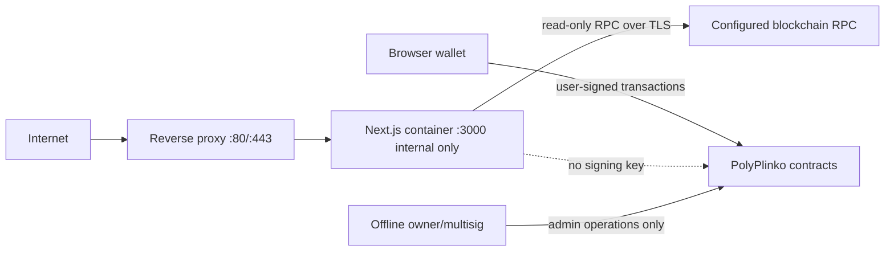

# Production Server Hardening

**Scope:** private, no-money VPS deployment. This document does not authorize
public-chain deployment or real-money funding.

## Architecture and trust boundaries

**VERIFIED:** Paid outcome, randomness, payout, token burn, bankroll
accounting, and settlement are contract state. The web server only serves the
application and performs read-only queries. The browser wallet signs paid
game and swap transactions.

The web container must contain no deployer, owner, treasury, dev-fee, or VRF
subscription private key. Administrative transactions must be performed from
an offline or separately controlled operator environment.

## Environment inventory

| Variable | Scope | Secret? | Required |
|---|---|---:|---|
| `APP_ENV` | server/build | no | yes; `private-local`, `public-readonly`, or `production` |
| `NEXT_PUBLIC_NETWORK_ID` | browser/build | no | yes; explicit chain ID |
| `NEXT_PUBLIC_GAME_CONTRACT_ADDRESS` | browser/build | no | yes; nonzero deployed address |
| `NEXT_PUBLIC_PPL_CONTRACT_ADDRESS` | browser/build | no | yes; nonzero deployed address |
| `NEXT_PUBLIC_RPC_URL` | browser/build | usually no | yes for the private local dry run; never embed a secret URL |
| `NEXT_PUBLIC_PAID_MODE_ENABLED` | browser/build | no | `false` for no-money VPS mode |
| `POLYGON_RPC_URL` | server runtime | potentially | required for public server reads; never `NEXT_PUBLIC_*` |
| `BLOCK_SCAN_FROM_BLOCK` | server runtime | no | required for production bounded history |
| `NEXT_PUBLIC_WC_PROJECT_ID` | browser/build | public identifier | only if wallet connector requires it |
| `DEPLOYER_PRIVATE_KEY`, `PRIVATE_KEY` | deployment only | **yes** | never present in web container |

`NEXT_PUBLIC_*` values are public. A provider URL containing a private API
token must not be placed in one. Production configuration now rejects missing
or non-public-chain configuration when `APP_ENV=production`; private-local
requires an explicit local chain configuration rather than silently falling
back to localhost.

The explicit `public-readonly` mode uses zero contract addresses and
`NEXT_PUBLIC_PAID_MODE_ENABLED=false`. It serves the landing/demo experience
and keeps paid hooks and transaction entry disabled; it does not silently
select localhost or a stale local deployment.

## Container controls

The private and production Compose files apply:

- multi-stage standalone Next build;
- non-root Next runtime user;
- no Docker socket and no host networking;
- read-only root filesystem with a bounded `/tmp` tmpfs;
- dropped Linux capabilities and `no-new-privileges`;
- CPU, memory, and PID limits;
- restart policy and lightweight RPC-backed `/api/health?ready=1` healthcheck;
- web service on an internal Docker network with no host port.

The reverse proxy has its own read-only filesystem and tmpfs paths. Nginx is
used only as the edge proxy; no admin dashboard, metrics endpoint, database,
or RPC service is exposed. The existing development Compose file remains
available separately.

For the private local dry run only, the web container reaches the host's
Hardhat RPC through an explicit `host.docker.internal` host-gateway mapping;
production configuration must use an outbound remote RPC URL instead.

## Verified private dry run

**TESTED:** A fresh local chain was started on chain 1337, the current game
and token were deployed and seeded, and `scripts/reconcile.ts` reported an
exact native reconciliation: 50 native in the contract, 25 house bankroll,
25 AMM reserve, zero locked/claim/dev-fee liabilities, and zero unclassified
surplus. The private stack served the homepage and APIs through
`127.0.0.1:8088`; its web container had no host port, ran as `nextjs`, and
was healthy under the RPC-backed readiness check.

**TESTED:** With the local RPC stopped, liveness remained HTTP 200 while
readiness returned HTTP 503 with `rpc_unavailable`; the game API returned 503
without claiming a result. After the RPC was restarted, the stack was
redeployed/reseeded and returned to healthy readiness.

## Network and firewall

Public inbound ports: TCP 80 and 443 only. Port 80 redirects to HTTPS in the
production template. The Next port 3000, local dry-run port 8088, Hardhat RPC
8545, Docker API, databases, and metrics/admin endpoints must not be exposed
to the Internet.

Outbound access is limited operationally to the configured RPC endpoint,
wallet/provider services required by the UI, and monitoring services. The
production RPC is read-only from this application; no signing key is present.

## Reverse proxy and headers

`nginx.production.conf` is TLS-ready and requires operator-provided
`ssl/fullchain.pem` and `ssl/privkey.pem`. It applies HTTP-to-HTTPS redirect,
request-size limits, connection/API rate limits, proxy timeouts, forwarded
headers, and does not enable WebSocket upgrade because the app does not
require it.

Next also emits CSP, anti-clickjacking, MIME-sniffing, referrer, and
permissions headers. HSTS is restricted to the TLS proxy template; it must not
be enabled on an HTTP-only private dry run. The CSP permits the inline scripts
required by the current Next.js runtime but does not permit `unsafe-eval`.

## API resource bounds

| Route | Auth | Main cost | Bound |
|---|---|---|---|
| `/api/health` | none | configuration check only | no chain scan |
| `/api/game/:id` | none | one contract read | game ID max 78 digits |
| `/api/stats/:address` | none | bounded `GameSettled` query | recent 100,000 blocks or explicit deployment block; 30s cache |
| `/api/security/check` | none | validation only; no security conclusion | strict address validation |
| `/api/prices` | none | one external price request | 60s cache; stale cache fallback |

The existing middleware and proxy rate limits are defense-in-depth, not a
distributed security boundary. Broad public launch still requires provider
timeouts/fallbacks and eventually a reorg-aware indexer. No route accepts a
caller-selected genesis-to-latest scan. Nginx rate-limits API traffic at
5 requests/second per source IP with a burst of 10; application middleware
adds 100 API requests/minute per `X-Real-IP`. Nginx overwrites `X-Real-IP`
from the socket address, and the application does not use caller-supplied
`X-Forwarded-For` for its limiter.

## Failure behavior

- If required production configuration is missing, health readiness returns
  `503` and server configuration fails closed.
- RPC outages result in bounded API errors; they do not settle games.
- Paid transaction success is determined by wallet/chain confirmation, not a
  server response.
- A web restart loses only process cache; on-chain games remain authoritative.
- Reverse-proxy or web failure causes downtime, not treasury control.

## Monitoring specification

Monitor system uptime/restarts, CPU, memory, disk, HTTP 5xx, latency, RPC
errors/429s/latency, and latest observed block age. Monitor protocol state:

- actual contract balance and reconciliation surplus;
- house, locked, and free bankroll plus utilization;
- largest and oldest pending game/VRF request;
- rejected games due to the 5% cap;
- failed-payout and developer-fee liabilities;
- AMM reserves, total supply, cumulative burns, and mining remaining;
- pause, shutdown, withdrawal, and configuration events.

Suggested initial alert thresholds are **OWNER REVIEW REQUIRED**: free-house
utilization above 50% warning, 70% high, and 85% critical; pending VRF age
above an operator-selected SLA; any accounting divergence; and abnormal AMM
reserve changes.

## Backups and operations

On-chain state is not backed up by the web server. Back up only an eventual
private indexer database, deployment metadata, monitoring configuration, and
versioned application configuration. Never copy privileged private keys into
ordinary server backups.

Privileged operations run off-server:

1. verify chain ID, contract addresses, bytecode, and release version;
2. inspect reconciliation, free bankroll, pending requests, and liabilities;
3. pause from the secure owner environment if incident response requires it;
4. restart or roll back the web image without touching contract state;
5. record transaction hashes and restore service only after reconciliation.

## Remaining blockers

This hardening work does not resolve the accepted open risks: stuck VRF
liveness, AMM/MEV manipulation, reorg-aware indexing, public-chain deployment,
or external legal/compliance review. These remain blockers for broad
real-money launch.
